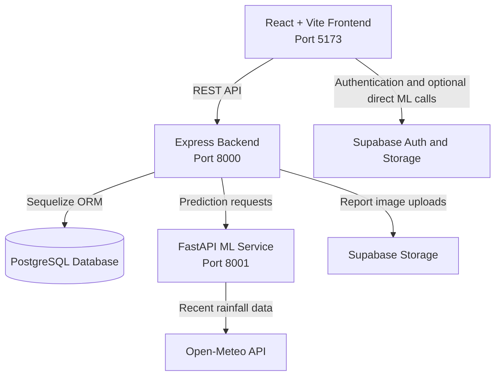

```markdown
# 🚨 CivicPulse AI — Civic Issue Reporting and Management

An AI-assisted civic-reporting platform that enables citizens to submit, track, and manage local issues. CivicPulse AI combines location-aware complaint submission, image-based analysis, rule-based triage, and an administrative dashboard to help communities respond to civic problems more efficiently.

The platform supports flooding and waterlogging, road damage, garbage and waste, power failures, and street-light issues.

---

## 🏗️ System Architecture

CivicPulse AI follows a three-service architecture consisting of a React frontend, an Express REST API, and a Python machine-learning service.



### 1. 💻 React Frontend (`/frontend`)

- **Core:** React 19, Vite, and React Router
- **Maps:** Leaflet and React Leaflet
- **Authentication:** Supabase client
- **API communication:** Axios
- **Reporting:** Complaint submission, photo uploads, and tracking workflows
- **Administration:** Dashboard filters, issue statistics, map views, and report export
- **Localization:** English, Sinhala, and Tamil interface translations
- **Appearance:** Light and dark themes
- **PDF export:** jsPDF and jsPDF AutoTable

### 2. 🔌 Express Backend (`/backend-express`)

- **Core:** Node.js and Express
- **Database:** PostgreSQL through Sequelize
- **File handling:** Multer for multipart complaint-image uploads
- **Image storage:** Supabase Storage
- **ML integration:** Sends prediction requests to the FastAPI service
- **Complaint management:** Report creation, retrieval, tracking, status updates, and administrator replies
- **Dashboard data:** Statistics, map pins, and incident summaries

### 3. 🧠 Python Machine Learning Service (`/backend-express/ml_service`)

- **API framework:** FastAPI with Uvicorn
- **Flood risk prediction:** scikit-learn and joblib
- **Garbage image classification:** TensorFlow/Keras and Pillow
- **Road-damage analysis:** Optional Ultralytics/YOLO support
- **Weather data:** Open-Meteo rainfall data for flood assessment
- **Model diagnostics:** Endpoints expose the availability and load status of prediction models

---

## 🌟 Key Product Features

### 👥 Public Complaint Reporting

- Submit a civic complaint without creating an account.
- Include issue details, optional GPS coordinates, and photos.
- Receive a unique complaint tracking ID.
- Track a guest report using its tracking ID and phone number.

### 🧠 AI-Assisted Issue Analysis

- **Flooding and waterlogging:** Assess flood risk using complaint details and, when coordinates are available, recent rainfall data.
- **Garbage and waste:** Classify uploaded waste images using the configured image-classification model.
- **Road damage:** Analyze road images when the required road-damage model and dependencies are available.
- **Complaint triage:** Apply rule-based triage and calculate severity and priority scores.

### 🗂️ Administrator Dashboard

- Review and filter submitted complaints.
- View issue statistics and incident summaries.
- Display reports with coordinates on a map.
- Update complaint statuses and provide administrator replies.
- Export reports for further review.

### 🧍 Citizen Portal and Tracking

- Check complaint progress.
- View administrator replies.
- Retrieve eligible reports associated with a phone number.
- Use the guest tracking flow without requiring a full user account.

### 🔐 Authentication and Access

- Use Supabase authentication.
- Look up user profiles and roles through the configured `user_profiles` and `user_roles` tables.
- Store report images in Supabase Storage.
- Keep the Supabase service-role key on the server only.

### 🌐 Accessibility and Interface

- English, Sinhala, and Tamil translations.
- Light and dark theme support.
- Map-based complaint visualization.

---

## 🧠 Machine Learning Engine Breakdown

The Python service exposes separate prediction endpoints for the available model types. Model availability depends on the presence and compatibility of the required artifacts.

### 1. 🌧️ Flood Risk Assessment

- Uses scikit-learn and joblib to load the flood prediction model and preprocessing artifacts.
- Supports prediction from feature data and assessment from complaint details.
- Can use coordinates to retrieve recent rainfall data from Open-Meteo.
- Falls back to zero rainfall values if the external weather request fails.
- Expected artifacts include a model, numerical and categorical imputers, model-column metadata, a label encoder, and a district lookup file.

### 2. 🗑️ Garbage Image Classification

- Uses TensorFlow/Keras and Pillow to process and classify uploaded waste images.
- Loads the configured `garbage_classifier_best.keras` artifact.
- Provides an endpoint to check whether the garbage model is available.

### 3. 🛣️ Road-Damage Analysis

- Supports optional Ultralytics/YOLO model inference.
- Expects the `best.pt` model artifact in the configured road-damage artifacts directory.
- The Express ML client currently calls `/predict-road-damage`, while the FastAPI application exposes `/analyze-road-damage`. Align these paths before expecting road-damage predictions through Express.
- Ultralytics is imported optionally but is not listed in `ml_service/requirements.txt`; install and verify it separately if required.

### 4. 🚦 Rule-Based Complaint Triage

- Evaluates submitted complaint information using the backend triage service.
- Assigns severity and priority scores for administrative review.
- Complements the ML predictions as part of the complaint-processing workflow.

> **Important:** AI features depend on the required model artifacts and compatible packages being installed. Check the ML service's model-status endpoints to verify availability. Do not assume a model is active just because its endpoint exists.

---

## ⚙️ Environment Configuration

### Backend Environment (`/backend-express/.env`)

Create a `.env` file in `backend-express/`:

```env
PORT=8000
DATABASE_URL=postgresql://<username>:<password>@<host>:<port>/<database>
CORS_ORIGIN=http://localhost:5173
ML_SERVICE_URL=http://127.0.0.1:8001
SUPABASE_URL=https://<project-ref>.supabase.co
SUPABASE_SERVICE_ROLE_KEY=<server-side-service-role-key>
SUPABASE_BUCKET=report-images
```

- `DATABASE_URL` must point to a PostgreSQL database.
- The backend uses SSL for its database connection.
- `SUPABASE_BUCKET` is optional and defaults to `report-images`.
- Keep `SUPABASE_SERVICE_ROLE_KEY` secret. Never place it in frontend environment variables or commit a real key.

### Frontend Environment (`/frontend/.env`)

Create a `.env` file in `frontend/`:

```env
VITE_SUPABASE_URL=https://<project-ref>.supabase.co
VITE_SUPABASE_ANON_KEY=<supabase-anon-key>
VITE_API_URL=http://127.0.0.1:8001
```

- Use the public/anon Supabase key in the frontend.
- `VITE_API_URL` is used by frontend components that call the ML service directly.
- The shared Axios client in `frontend/src/services/api.js` currently uses `http://127.0.0.1:8000` as its Express API base URL. Update that value if your backend uses a different address.

Configure the required Supabase `user_profiles` and `user_roles` tables for profile and role lookup, and configure the Storage bucket used for report images.

---

## 🚀 Installation and Running Guide

### Prerequisites

Install and configure:

- Node.js and npm
- Python 3.9 or newer
- PostgreSQL
- A Supabase project for authentication and image storage
- The model artifacts required for the ML features you intend to use

Run each service in a separate Windows PowerShell terminal from the project root.

### Step 1: 🧠 Start the ML Service

```powershell
cd backend-express/ml_service
py -m venv .venv
.\.venv\Scripts\Activate.ps1
pip install -r requirements.txt
uvicorn app:app --reload --host 0.0.0.0 --port 8001
```

The ML API should be available at `http://127.0.0.1:8001`.

Interactive API documentation: `http://127.0.0.1:8001/docs`

If PowerShell blocks environment activation, use Command Prompt:

```bat
.venv\Scripts\activate.bat
```

### Step 2: 🔌 Start the Express Backend

Open another terminal:

```powershell
cd backend-express
npm install
npm run dev
```

The backend should be available at `http://localhost:8000`. The root endpoint (`/`) returns a service health response.

### Step 3: 💻 Start the React Frontend

Open a third terminal:

```powershell
cd frontend
npm install
npm run dev
```

Vite serves the frontend at `http://localhost:5173` by default.

Open that address in your browser after all required services and environment variables are configured.

---

## 🔗 API Reference

### Express REST API — Port `8000`

| Method | Endpoint | Purpose |
|---|---|---|
| `GET` | `/` | Backend health response |
| `POST` | `/predict` | Submit a complaint, run triage/prediction, and save it |
| `GET` | `/reports` | List reports with optional category, severity, and status filters |
| `GET` | `/reports/:id` | Retrieve a report by database ID or tracking ID |
| `POST` | `/reports/sync` | Fetch reports using a list of identifiers |
| `POST` | `/reports/track-guest` | Track a report using its tracking ID and phone number |
| `GET` | `/reports/by-phone/:phone` | Find reports associated with a phone number |
| `PATCH` | `/reports/:id/status` | Update a report's status |
| `PATCH` | `/reports/:id/reply` | Add an administrator reply |
| `DELETE` | `/reports/:id` | Delete a report |
| `GET` | `/stats` | Retrieve dashboard statistics |
| `GET` | `/map-pins` | Retrieve reports with coordinates for the map |
| `GET` | `/incidents` | Retrieve incident summaries |

### FastAPI Machine Learning API — Port `8001`

| Method | Endpoint | Purpose |
|---|---|---|
| `GET` | `/` | ML service health and model-load status |
| `GET` | `/model-status` | Check flood model status |
| `POST` | `/predict` | Predict flood risk from feature data |
| `POST` | `/predict-from-complaint` | Assess flood risk using complaint details |
| `GET` | `/garbage-model-status` | Check garbage model status |
| `POST` | `/predict-garbage` | Classify an uploaded waste image |
| `GET` | `/road-damage-model-status` | Check road-damage model status |
| `POST` | `/analyze-road-damage` | Analyze an uploaded road image |

---

## 📦 Machine Learning Model Artifacts

The ML service expects model artifacts under `backend-express/ml_service/artifacts/`:

```text
artifacts/
├── flood/
│   ├── flood_model.pkl
│   ├── num_imputer.pkl
│   ├── cat_imputer.pkl
│   ├── model_columns.pkl
│   ├── label_encoder.pkl
│   └── district_lookup.json
├── garbage/
│   └── garbage_classifier_best.keras
└── Road_Damage/
    └── best.pt
```

Model files are excluded by the repository's `.gitignore`. Ensure required files are available locally or provide an authorized download/setup method. Check `/model-status`, `/garbage-model-status`, and `/road-damage-model-status` to inspect model availability.

---

## 📁 Core Project Structure

```text
CivicPulseAI---Management-system/
├── README.md
├── frontend/
│   ├── public/                  # Static assets
│   ├── src/
│   │   ├── components/          # Complaint form, dashboard map, shared UI
│   │   ├── context/             # Auth, language, and theme contexts
│   │   ├── lib/                 # Supabase client
│   │   ├── pages/               # Home, complaint, dashboard, citizen portal
│   │   ├── services/            # Express API client
│   │   ├── App.jsx               # Application routing
│   │   └── main.jsx              # Frontend entry point
│   ├── package.json
│   └── vite.config.js
└── backend-express/
    ├── ml_service/
    │   ├── app.py                # FastAPI prediction service
    │   ├── artifacts/            # Flood, garbage, and road model files
    │   └── requirements.txt      # Python dependencies
    ├── src/
    │   ├── config/               # PostgreSQL connection
    │   ├── middleware/           # Upload middleware
    │   ├── models/               # Sequelize models
    │   ├── routes/               # Express API routes
    │   ├── services/             # Triage, ML client, storage helpers
    │   └── utils/                # Utility functions
    ├── uploads/                  # Local upload directory
    ├── package.json
    └── server.js                 # Backend entry point
```

---

## 🧪 Development Checks

From the `frontend/` directory:

```powershell
npm run lint
npm run build
```

Run these checks before submitting changes or preparing a deployment.

---

## 🔒 Security and Deployment Notes

- Never expose or commit the Supabase service-role key.
- Use the public/anon key in the frontend and enforce suitable authorization policies for database and Storage access.
- Configure appropriate Row Level Security (RLS) policies and database permissions for production.
- The Express upload route accepts up to 10 images, with a 10 MB size limit per image.
- The ML service uses Open-Meteo rainfall data when coordinates are supplied. If the external weather request fails, it falls back to zero rainfall values.
- Sequelize synchronization currently uses `alter: true` during startup. For production deployments, use database migrations and appropriately restricted database credentials.
- Confirm CORS origins, secrets, model files, database connectivity, and service URLs before deployment.
- Ensure road-damage endpoint paths are aligned between Express and FastAPI before relying on that prediction flow.

---

## 📄 License

Add the applicable license and attribution information for CivicPulse AI and its model assets before distributing the project.
```
