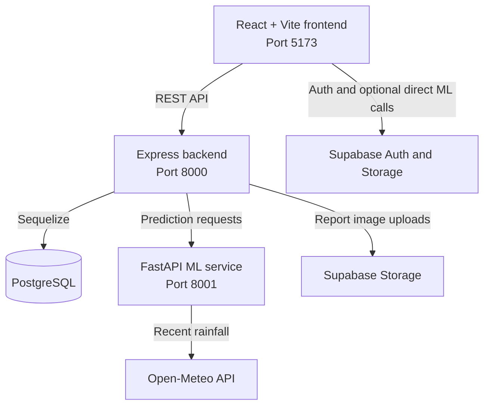

# CivicPulse AI — Civic Issue Reporting and Management

CivicPulse AI is a civic-reporting platform for submitting, tracking, and managing local issues. Citizens can report an issue with location details and photos; the system stores the report, applies triage and AI-assisted analysis, and lets administrators review cases and update their status.

The current issue categories include flooding and waterlogging, road damage, garbage and waste, power failures, and street lights.

## Features

- Public complaint submission without requiring an account
- Optional GPS location and photo uploads
- Unique complaint tracking IDs and guest tracking using the ID and phone number
- AI-assisted flood risk, garbage image classification, and road-damage analysis
- Rule-based complaint triage with severity and priority scores
- Admin dashboard with filters, issue statistics, maps, status updates, and report export
- Citizen portal for checking complaint status and administrator replies
- Supabase authentication with profile and role lookup
- English, Sinhala, and Tamil interface translations
- Light and dark theme support
- PostgreSQL-backed report, image, incident, and resource models

## Architecture

The application has a React frontend, an Express API, and a Python ML service.



### Frontend — `frontend/`

- React 19, Vite, and React Router
- Leaflet and React Leaflet for maps
- Supabase client for authentication
- Axios for API requests
- jsPDF and jsPDF AutoTable for PDF export

### Backend — `backend-express/`

- Node.js and Express
- PostgreSQL through Sequelize
- Multer for multipart complaint-image uploads
- Supabase Storage for report images
- Routes for reports, prediction, statistics, incidents, and map pins

### ML service — `backend-express/ml_service/`

- FastAPI with Uvicorn
- scikit-learn and joblib for flood risk prediction
- TensorFlow/Keras and Pillow for garbage image classification
- Ultralytics/YOLO model support for road-damage analysis when installed
- Open-Meteo for recent rainfall data used in flood assessment

## Project structure

```text
CivicPulseAI---Management-system/
├── README.md
├── frontend/
│   ├── public/
│   ├── src/
│   │   ├── components/       # Complaint form, dashboard map, shared UI
│   │   ├── context/          # Auth, language, and theme contexts
│   │   ├── lib/              # Supabase client
│   │   ├── pages/            # Home, complaint, dashboard, and citizen portal
│   │   ├── services/         # Express API client
│   │   ├── App.jsx
│   │   └── main.jsx
│   ├── package.json
│   └── vite.config.js
└── backend-express/
    ├── ml_service/
    │   ├── app.py             # FastAPI prediction service
    │   ├── artifacts/         # Flood, garbage, and road model files
    │   └── requirements.txt
    ├── src/
    │   ├── config/            # PostgreSQL connection
    │   ├── middleware/        # Upload middleware
    │   ├── models/             # Sequelize models
    │   ├── routes/             # Express API routes
    │   ├── services/           # Triage, ML client, and storage helpers
    │   └── utils/
    ├── uploads/
    ├── package.json
    └── server.js
```

## Requirements

- Node.js and npm
- Python 3.9 or newer
- PostgreSQL database
- Supabase project for authentication and image storage
- The ML model artifacts required for the predictions you want to run

## Configuration

Create `backend-express/.env`:

```env
PORT=8000
DATABASE_URL=postgresql://<username>:<password>@<host>:<port>/<database>
CORS_ORIGIN=http://localhost:5173
ML_SERVICE_URL=http://127.0.0.1:8001
SUPABASE_URL=https://<project-ref>.supabase.co
SUPABASE_SERVICE_ROLE_KEY=<server-side-service-role-key>
SUPABASE_BUCKET=report-images
```

`DATABASE_URL` must point to a PostgreSQL database. The backend uses SSL for its database connection. `SUPABASE_BUCKET` is optional and defaults to `report-images`.

Create `frontend/.env`:

```env
VITE_SUPABASE_URL=https://<project-ref>.supabase.co
VITE_SUPABASE_ANON_KEY=<supabase-anon-key>
VITE_API_URL=http://127.0.0.1:8001
```

The frontend's shared Axios client currently uses `http://127.0.0.1:8000` as its Express API base URL in `frontend/src/services/api.js`. Update that value there when using a different backend address. `VITE_API_URL` is used by frontend components for direct ML-service requests.

> Never expose `SUPABASE_SERVICE_ROLE_KEY` in the frontend or commit real secrets. Only use the public/anon Supabase key in the frontend. Configure the required Supabase `user_profiles` and `user_roles` tables for profile and role lookup.

## Run locally (Windows PowerShell)

Start each service in its own terminal from the project root.

### 1. Start the ML service

```powershell
cd backend-express/ml_service
py -m venv .venv
.\.venv\Scripts\Activate.ps1
pip install -r requirements.txt
uvicorn app:app --reload --host 0.0.0.0 --port 8001
```

The ML API will be available at `http://127.0.0.1:8001`. FastAPI's interactive API documentation is available at `http://127.0.0.1:8001/docs`.

If PowerShell blocks environment activation, use Command Prompt:

```bat
.venv\Scripts\activate.bat
```

### 2. Start the Express backend

```powershell
cd backend-express
npm install
npm run dev
```

The backend will be available at `http://localhost:8000`. The root endpoint (`/`) returns a service health response.

### 3. Start the frontend

```powershell
cd frontend
npm install
npm run dev
```

Vite serves the frontend at `http://localhost:5173` by default.

## API overview

### Express API — port `8000`

| Method | Endpoint | Purpose |
|---|---|---|
| `GET` | `/` | Backend health response |
| `POST` | `/predict` | Submit a complaint, run triage/prediction, and save it |
| `GET` | `/reports` | List reports, with optional category/severity/status filters |
| `GET` | `/reports/:id` | Get a report by database ID or tracking ID |
| `POST` | `/reports/sync` | Fetch reports by a list of identifiers |
| `POST` | `/reports/track-guest` | Track a report using its tracking ID and phone number |
| `GET` | `/reports/by-phone/:phone` | Find reports associated with a phone number |
| `PATCH` | `/reports/:id/status` | Update a report's status |
| `PATCH` | `/reports/:id/reply` | Add an administrator reply |
| `DELETE` | `/reports/:id` | Delete a report |
| `GET` | `/stats` | Retrieve dashboard statistics |
| `GET` | `/map-pins` | Retrieve reports with coordinates for the map |
| `GET` | `/incidents` | Retrieve incident summaries |

### FastAPI ML API — port `8001`

| Method | Endpoint | Purpose |
|---|---|---|
| `GET` | `/` | ML service health and model-load status |
| `GET` | `/model-status` | Status of all ML models |
| `POST` | `/predict` | Flood prediction from feature data |
| `POST` | `/predict-from-complaint` | Flood risk assessment using complaint details |
| `GET` | `/garbage-model-status` | Garbage model status |
| `POST` | `/predict-garbage` | Classify an uploaded waste image |
| `GET` | `/road-damage-model-status` | Road-damage model status |
| `POST` | `/analyze-road-damage` | Analyze an uploaded road image |

## Model artifacts

The ML service expects artifacts under `backend-express/ml_service/artifacts/`:

```text
artifacts/
├── flood/
│   ├── flood_model.pkl
│   ├── num_imputer.pkl
│   ├── cat_imputer.pkl
│   ├── model_columns.pkl
│   ├── label_encoder.pkl
│   └── district_lookup.json
├── garbage/
│   └── garbage_classifier_best.keras
└── Road_Damage/
    └── best.pt
```

Model files are excluded by the repository's `.gitignore`. Ensure the required model files are available locally or provide an authorized download/setup method. The service reports model availability at `/model-status`; a missing or incompatible artifact can disable that prediction feature.

## Development checks

From `frontend/`:

```powershell
npm run lint
npm run build
```

## Notes

- The backend calls the ML service using `ML_SERVICE_URL`, which defaults to `http://localhost:8001`.
- The Express ML client currently calls `/predict-road-damage`, while the FastAPI app exposes `/analyze-road-damage`. Align these paths before expecting road-damage predictions through Express.
- Ultralytics is imported optionally by the ML service but is not listed in `ml_service/requirements.txt`; install and verify it separately if road-damage inference requires it.
- Complaint photos can be submitted as multipart form data. The Express prediction route accepts up to 10 images, with a 10 MB file-size limit per image.
- Flood assessment can use Open-Meteo rainfall data when coordinates are supplied. If the external weather request fails, the ML service falls back to zero rainfall values.
- Backend Sequelize model synchronization currently uses `alter: true` during startup. Use migrations and appropriate database access controls for production deployments.

## License

Add the applicable license and attribution information for this project and its model assets before distributing it.
